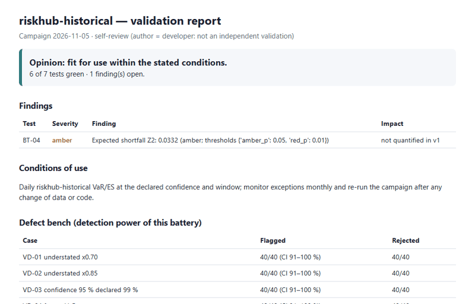

# valkit — model validation assistant

Python toolkit that runs a battery of validation tests on a pricing or risk model, with thresholds fixed before the run, and writes a deterministic `facts.json` per campaign.

**Limits, up front:** the defects in the bench are written by the author (not blind); both campaigns are self-reviews (author = developer), not independent validations; some rules were changed after seeing results (see the bench section) before any `thresholds-v1` tag existed. To validate your own model, see [ADAPTING.md](ADAPTING.md).

**Status: v0.1, steps 1–8 of the plan** (VaR and pricing checks, findings/opinion/`guard`, public planted-defect bench, HTML report, YAML registry). Done: three blind sub-agent waves (below). Not done: defects written by a human third party (protocol in `defects/README.md`), expert-written commentary. Published reports live in `docs/` (GitHub Pages); thresholds are listed in `THRESHOLDS.md`.

```bash
pip install -e ".[dev,pricing]"
valkit fetch configs/riskhub_var_portfolio.yaml   # downloads prices, writes SHA-256 fingerprint (CSV is not redistributed)
valkit run configs/riskhub_var_portfolio.yaml     # -> campaigns/<model>/<date>/facts.json
valkit run configs/financepy_heston.yaml          # ~7 min on a 16 GB laptop
pytest --cov=valkit   # 28 tests, 82 % coverage
```

| ID | Test |
|---|---|
| BT-01 | Kupiec POF, with power vs 2p and measured size (exact binomial p reported as evidence; the asymptotic p sets the status) |
| BT-02 | Christoffersen independence / conditional coverage, with power vs clusters |
| BT-03 | Basel traffic light (+ multiplier add-on at N=250, 99 %) |
| BT-04 | Acerbi–Székely Z2 for ES (null simulated under Gaussian and Student-t(4) tails; the larger p decides) |
| BM-02 | VaR vs `numpy.quantile` |
| BM-01 | Heston implied-vol error (bp) vs QuantLib analytic, and vs QuantLib Monte Carlo QE (outside its 99 % CI) |
| CV-01 | Monte Carlo standard-error slope vs paths |
| SE-01 | Finite-difference delta vs QuantLib |
| ST-01 | Stress parameters (Feller violation, rho ±0.95, one week, wings) |
| LU-01 | Largest scaled parameter box within tolerance |
| DR-01 | PSI / KS of inputs actually used vs declared domain (needs real usage data) |
| BM-03 | ES vs mean of the k worst returns of the same window (sharp where Z2 has little power) |
| RP-01 | Two runs give byte-identical facts |

Each campaign also writes `findings.json` (non-green tests, ranked, with a quantified impact: Basel multiplier add-on for VaR, price gap and proposed reserve on a test book for pricing), and `conditions_of_use.json` (deterministic opinion, validated domain). `valkit.findings.guard(path)` decorates `price(self, p)` and refuses inputs outside that domain, or any use when the opinion is "not fit for use". An indicative test (power < 0.5) can lower the opinion to "with conditions" at most, never to "not fit".

Measured, not assumed: at N=250, p=1 % the asymptotic Kupiec test rejects ≈ 9–10 % of correct models at the 5 % level, and has ≈ 24 % power against a doubled exception rate, so it is flagged *indicative*.

The riskhub-engine campaign is a **self-review** (author = developer), not an independent validation.

FinancePy and QuantLib's analytic engine both use the characteristic-function family, so their agreement (~1e-8 bp) is weak evidence; the Monte Carlo QE comparison is the only genuinely different method.

Each campaign also writes `report.html` (one-screen summary, then detail; prints to PDF from the browser) and upserts `registry/models.yaml` (pydantic-validated). The VaR campaign is labelled *self-review*.




## Defect bench (`valkit bench`, ~12 min)

Public taxonomy in `src/valkit/bench.py`: 8 VaR defects (40 seeds of iid Student-t data) and 9 pricing defects (12 seeds of Sobol test points), plus healthy models. *Flagged* = opinion is not "fit"; *rejected* = "not fit for use". 95 % Wilson intervals in `campaigns/bench/<date>/bench.json`.

First run (2026-11-05, before fixes): ES = VaR was flagged only 10/40 (the Z2 ES backtest has little power at 250 days), and the healthy VaR got an amber from some test in 9/40 runs. Two fixes, then a second run:
- ES is backtested on the full out-of-sample, and a deterministic benchmark BM-03 (ES vs the mean of the k worst returns) was added.
- A lone amber from a p-value test (BT-01/02/04) with nothing else non-green is listed as a finding but does not change the opinion ("not corroborated").

Second run: every VaR defect and every pricing defect is rejected (VaR 40/40, pricing 12/12); the healthy VaR is flagged 4/40 (95 % CI 4–23 %) and rejected 0/40; healthy FinancePy is flagged 0/12. The price of the corroboration rule: a real defect that only trips one p-value test would now go unflagged. BM-03 detects ES = VaR by construction (same convention as the model), not an ES that is wrong in a model-risk sense.

Third run (2026-11-05, after the latest changes): BT-04 now takes the larger p over two tail laws; the Kupiec exact p was added as evidence; four subtle defects were added (VaR ×0.95, a 20-day window, `v0` +1 %, `kappa` +10 %). Result: all 8 VaR defects rejected 40/40, all 9 pricing defects rejected 12/12, healthy VaR flagged 4/40 and healthy FinancePy 0/12. The subtle defects were caught more easily than I expected, which says the tolerances are tight and that the defects are not hard; it does not show the battery would catch a defect I did not think of.

**Disclosure:** the BM-03 test, the corroboration rule and the two-null BT-04 were all introduced after looking at bench results, before the `thresholds-v1` tag. The bench is therefore tuned on its own defects; only the blind third-party defects (`defects/README.md`) can test that.

Real-data results (self-review): FinancePy Heston is green on 7/7 tests; riskhub-engine historical VaR has one amber, BT-04 (p = 0.021 Gaussian null, 0.033 Student-t(4) null), listed as a finding but not corroborated, so the opinion stays "fit for use within the stated conditions".

Limits: defects are written by the author (not blind), pricing defects are large relative to the tolerances, 12 seeds give wide intervals, and the Z2 null only covers two tail shapes (an amber BT-04 may still come from a third).

## Blind run 1 (`blind/`, 8 models written by sub-agents)

Protocol: eight independent Claude sub-agents each drew at random (with `secrets`) whether to write a healthy or a defective 99 % / 500-day VaR/ES model, chose the defect family and difficulty themselves, and wrote a sealed `answer.json`. The author of the toolkit did not read any model or key before the run. SHA-256 of every file were committed first (`blind/HASHES.txt`, commit `7d8c2cf`), then `blind/run_blind.py` ran the unchanged battery (thresholds `thresholds-v1`) on the real multi-asset portfolio. The keys were read afterwards and the hashes verified.

| | Truth | Opinion of the battery |
|---|---|---|
| B01, B04, B07, B08 | healthy | **not fit for use** (4/4 false alarms) |
| B02 (ES on a 250-day sub-window, subtle) | defective | not fit for use |
| B03 (95 % level instead of 99 %, obvious) | defective | not fit for use |
| B05 (ES drops the worst loss, subtle) | defective | not fit for use |
| B06 (250-day instead of 500-day window, moderate) | defective | not fit for use |

Detection 4/4, but **specificity 0/4**: the battery rejects everything, so this run does not show it discriminates. Causes, diagnosed after the run:
- BM-02 compares the VaR with `numpy.quantile(..., method="inverted_cdf")` at a 1e-3 tolerance. The healthy models use the other standard convention (linear interpolation, gap to numpy 5e-16), which differs by up to 6 % on a 5-point tail, so BM-02 is red for any correct model that does not copy the author's convention.
- BT-04 is red (p = 0.006) for the healthy models, amber (p = 0.033) for riskhub's own: on this heavy-tailed portfolio a 500-day historical ES is genuinely light, and the ES definitions differ slightly.
- The earlier "healthy VaR flagged 4/40" figure was circular: the healthy model there was the benchmark's own implementation.

Changes made after seeing run 1, before run 2 (tag `thresholds-v2`, commit `6480567`): BM-02 accepts the closer of the two quantile conventions. BT-04 is left unchanged, because the red on healthy models comes from the real heavy-tailed data, not from a flaw in the test. The eight run-1 models are burned (their keys were read), so run 2 uses fresh ones.

## Blind run 2 (`blind/B09`–`B16`, thresholds `thresholds-v2`)

Same protocol with eight new sub-agents. This time only the hashes and `model.py` files were committed before the run (commit `261a244`); the keys stayed local until after it. Each model ran on 30 synthetic i.i.d. Student-t(4) series (known truth, 1250 days, seeds 100-129) and on the real portfolio. Hashes verified afterwards.

| Model | Truth | Synthetic: fit / conditions / not fit | Real portfolio |
|---|---|---|---|
| B09, B11 | healthy (historical simulation) | 22 / 8 / 0 each | not fit |
| B10, B13, B14 | 95 % level instead of 99 % (obvious) | 0 / 0 / 30 each | not fit |
| B12, B16 | ES averaged beyond the 97.5 % quantile (moderate) | 0 / 0 / 30 each | not fit |
| B15 | ES drops the worst loss (subtle) | 0 / 0 / 30 | not fit |

- Detection: 6/6 defective models rejected on every synthetic series (180/180) and on the real data.
- Healthy models on known-truth data: 0/60 rejected (Wilson 95 % upper bound about 6 %), 16/60 "fit with conditions", 44/60 fit. The conditions come from isolated ambers, not reds.
- On the real portfolio both healthy models are still "not fit for use", the BT-04 effect from run 1. A real 500-day historical ES is light on this data, so the real-data opinion cannot separate healthy from defective models here.
- Post-hoc check, not part of the pre-registered run (portfolios chosen after seeing the results, four models only): on a 60/40 S&P 500 / TLT portfolio the two healthy models are "fit for use within the stated conditions" while B10 and B15 are "not fit"; on the S&P 500 alone BT-04 is red for the healthy models too. The real-data false alarm therefore depends on the tail and clustering of the portfolio, not on the models.
- Only two healthy models, so the specificity estimate is weak. Models are not independent of the author's model family: every sub-agent chose historical simulation.

## Blind pricing run (`blind/pricing/P01`–`P06`, thresholds `thresholds-v2`)

Six sub-agents each wrote an independent Heston call pricer (numpy/scipy only) after a random draw healthy / defective. Hashes and `model.py` were committed before the run (`3bc3fda`), the full six-test pricing battery ran, then the keys were read and the hashes verified.

| Model | Truth | Battery as run | With fixed-strike spot bump |
|---|---|---|---|
| P01, P02 | healthy | not fit (SE-01 red) | **fit** (all green) |
| P03 | defective (obvious) | not fit | not fit (BM-01, SE-01, LU-01) |
| P04 | defective (subtle) | not fit | not fit (BM-01 red) |
| P05, P06 | defective | not fit | not fit (BM-01, SE-01, LU-01) |

- Defect detection is 4/4 under both readings.
- The first column is the unchanged battery, and it also rejected both healthy models. Cause: my brief did not say the strike stays fixed when the spot is bumped, so the authors re-derived the strike from the bumped spot and the finite-difference delta came out wrong (about 0.18 vs 0.76). SE-01 flagged that correctly; the flaw is in the brief, not the pricing.
- The second column is a post-hoc re-run through a thin wrapper that keeps the strike fixed (`k' = k + ln(100/spot)`), chosen after seeing the first column (`blind/pricing/run_fixed_strike.py`). Report both: specificity is 0/2 false alarms only under the corrected reading.
- Caveats: only two healthy models, all authors are the same model family and picked similar Lewis / Gil-Pelaez integrals, so the specificity estimate is weak.

## Blind pricing run 2 (`blind/pricing/P07`-`P14`, thresholds `thresholds-v2`, fixed-strike brief)

Same protocol, with the brief corrected (strike stays fixed under a spot bump) and the battery run unchanged, no wrapper. Rule (`WAVE3-RULE.md`), brief and sealed hashes (`HASHES3.txt`) were committed before the run (`4da6daf`); answers were read only after the raw results were saved, and all hashes verified.

| Model | Truth | Verdict |
|---|---|---|
| P07 | defective: variance floor clips v0 up to 0.04 | not fit (BM-01, SE-01, LU-01 red) |
| P08 | defective: little-trap branch swapped | not fit |
| P09 | defective: discount factor exp(+rT) | not fit |
| P12 | defective: coarse integration grid | not fit |
| P14 | defective: no discounting | not fit |
| P10, P11, P13 | healthy | **fit**, all six checks green |

- Detection 5/5 (Wilson 95 % CI 57-100 %), false alarms 0/3 (CI 0-56 %).
- Together with run 1 under the fixed-strike reading: 9/9 defects rejected, 0/5 healthy models rejected. The first run's SE-01 failure was the brief, not the battery.
- Limits: small n; all authors are one model family; the defects drawn were mostly large, so subtle ones (cf. P04-P06) remain the better test of power.
